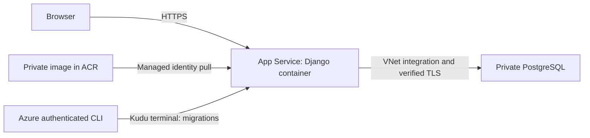

# Step 3: Azure deployment

For the clarified **single-server university demo**, prefer the
[single Azure VM deployment](azure_vm_deployment.md): Docker Compose runs Django,
PostgreSQL, and an HTTPS proxy together. Azure rejected the original B1ms quote.
The available 4 GiB B2als v2 replacement has an estimated **$33.50 USD/month**
baseline including disk/IP. It is now deployed; see [live status](azure_vm_status.md).
This replaces the managed-services proposal as the recommendation for the demo.

The **managed-services alternative** documented below uses **App Service Linux B1**, **PostgreSQL Flexible
Server B1ms (version 17, 32 GB)**, and **Basic Azure Container Registry**, in
North Central US. Canada Central was rejected by the student subscription's
regional deployment policy. This proposal therefore stores application data in
the United States. See [hosting research](azure_hosting_research.md) for the alternatives
and verified Microsoft pricing sources. No application dependency was added.

## Cost proposal

Retail estimate checked 23 November 2026, in USD, using 730 hours per month:

| Resource | Approximate monthly cost |
| --- | ---: |
| App Service Linux B1, one instance | $13.14 |
| PostgreSQL B1ms compute | $12.41 |
| PostgreSQL 32 GB storage | $3.68 |
| ACR Basic, approximately 30 days | $5.00 |
| One private DNS zone | $0.50 |
| **Baseline** | **$34.73** |

DNS queries, data transfer, excess registry/backup storage, taxes and currency
conversion can add cost. This is an estimate, not a spending cap. At this
baseline $100 lasts approximately 2.9 months, assuming no other consumption.
Do not assume first-year free services apply: eligible PostgreSQL allowances
could lower the bill, while the advertised student ACR offer is for Standard,
not a promise of free Basic. Confirm eligibility/expiry in the portal before
changing SKUs. Keep the student spending limit enabled; do not upgrade to
pay-as-you-go merely to resolve capacity or regional restrictions.

Authenticated checks found an enabled Azure for Students subscription with its
spending limit on. Although Canada Central advertises the services, a what-if
preview rejected it under the subscription's allowed-region policy. The actual
allowed list is North Central US, Belgium Central, Sweden Central, Denmark East,
and Norway East. North Central US advertises PostgreSQL B1ms and version 17.
The foundation what-if preview succeeded there. These checks do not reserve
capacity or establish remaining credit, free-service eligibility, or quota.

## Architecture and files



- `infra/azure/main.bicep` creates a dedicated resource group and foundation.
- `infra/azure/foundation.bicep` defines the plan, registry, pull identity, VNet,
  delegated subnets, private DNS, database, extension allowlist, and backups.
- `infra/azure/web.bicep` deploys the image, HTTPS settings, and application
  environment. Host settings use Azure's actual `defaultHostName` rather than
  guessing a generated URL. The default blocks public application access.
- `scripts/azure_deploy.py` provides explicit deployment stages. It targets
  the subscription recorded locally on every Azure call, independently of the
  Azure CLI's default subscription.
- `tests/test_azure_deploy.py` checks private credentials, migration/publication
  safeguards, terminal result handling, and compiled infrastructure settings.

PostgreSQL has public networking disabled and lives in its own delegated subnet.
The app uses a separate subnet and private DNS to reach it. TLS checks the server
hostname against the image's trusted CA bundle. The existing `btree_gist`
migration requires the server's `azure.extensions` allowlist, configured first.
ACR requires authentication; its admin account and anonymous pulls are disabled.
A user-assigned identity gets only the registry's `AcrPull` role.

App Service terminates HTTPS; Django retains secure cookies, redirects, host
validation and production settings. The web template enables forwarded-protocol
trust for this direct App Service proxy path. Verify redirects and login CSRF in
the deployed environment before sharing the URL. Do not expose another container
port around the proxy.

The database has seven-day locally redundant backups. This is one small web
instance and one database without high availability; restore testing, alerting,
and capacity/load testing remain necessary for a sustained production service.

## Prerequisites and sign-in

Use Docker Desktop with WSL integration, Azure CLI **2.90 or newer**, and Bicep.
These are deployment tools, not Python application dependencies. Use `az login`
with the supported normal browser flow. In this session the university rejected
device-code authentication (53003), while normal browser authentication worked.
Do not disable university policies, export browser tokens, or change tenants as
a workaround. An institutional administrator must resolve a blocked normal flow.

## Deployment stages

From the repository root, with Azure CLI signed in:

```bash
uv run python scripts/azure_deploy.py prepare --subscription <student-subscription-id> --location northcentralus
uv run python scripts/azure_deploy.py plan
```

`prepare` generates independent random database/Django secrets in ignored
`.azure-deploy/state.json` (directory mode 0700, file 0600). Keep that directory
private and back it up securely; do not delete it and regenerate credentials for
an existing server. `plan` runs Azure what-if and stores its preview locally;
it does not create resources. Secure template parameters use temporary private
files, not command-line secret values. Azure application settings still contain
the runtime credentials and require appropriately restricted Azure permissions.

**After approving the billable resource proposal:**

```bash
uv run python scripts/azure_deploy.py provision --approve-costs
uv run python scripts/azure_deploy.py build
uv run python scripts/azure_deploy.py deploy-web
uv run python scripts/azure_deploy.py migrate
```

Provisioning registers the required providers and creates the foundation. Build
pushes the runtime Docker image and records its immutable registry digest. The
web app starts with public application access denied; its SCM administrative
endpoint remains Azure authenticated, with basic publishing passwords disabled.

Migration uses the running app's own private database connection. It selects a
single instance and observes `migrate --noinput` and `check --deploy` through
[authenticated container execution](https://learn.microsoft.com/en-us/azure/app-service/configure-linux-open-ssh-session).
There is no SSH server/password added to the image. The CLI command is currently
preview; the script verifies the shell's real exit status rather than accepting
detached-command submission as success. It waits for the CLI to finish setting
up its raw terminal before sending input, avoiding input discarded on connection.
If completion is interrupted or unknown, inspect that instance before retrying;
the script never automatically retries migrations.

Then create an owner account using an authenticated `az webapp exec` shell and
`cd /app && /app/.venv/bin/python manage.py createsuperuser`. Enter its password
privately. Do not publish the documented local `seed_demo` accounts/passwords;
they are shared development credentials. The cloud database starts empty and
does not copy the local development database.

After verified migration success and private inspection:

```bash
uv run python scripts/azure_deploy.py publish
uv run python scripts/azure_deploy.py status
```

Publication requires a successful migration receipt for the selected digest and
checks that the configured image has not changed. This receipt records the CLI's
observed result; it is not a cryptographic attestation or a general release system.
Only run one deployment operator at a time. Subsequent `build` and `deploy-web`
stages invalidate the receipt and require another migration verification. Later
releases temporarily close public access; B1 has no deployment slots here.

## Validation and operations

```bash
# Compiles templates as part of the tests when bicep is on PATH:
uv run pytest tests/test_azure_deploy.py tests/test_deployment.py tests/test_config.py
# Or set BICEP_BIN=/absolute/path/to/bicep for the infrastructure checks.
bicep build infra/azure/main.bicep --outfile /tmp/schedule-foundation.json
bicep build infra/azure/web.bicep --outfile /tmp/schedule-web.json
```

After publication verify HTTPS `/healthz/`, login, CSRF-protected form submission,
static CSS, commitment persistence, and account isolation. Liveness deliberately
does not query the database; it cannot establish migration or database readiness.
Do not report the app as deployed until these live checks pass.

Monitor credit/usage in Cost Management and configure budget notifications. A
budget is an alert, not a hard cap. Stopping the web app does not stop its paid
App Service plan; PostgreSQL storage also remains billable when the server is
stopped and PostgreSQL can restart automatically after seven days. Complete
cleanup requires deleting the dedicated resources, including plan, database and
registry. Export needed data first and obtain explicit deletion approval: deleting
the resource group destroys its database and recovery resources.

As prepared, the foundation and web templates compile and local deployment tests
pass. Azure provisioning and live application verification remain separate steps.
