# GitHub Actions CI/CD

The [Test and deploy workflow](https://github.com/Bijay4444/Smart_Schedule_and_Availability_Manager/actions/workflows/ci-cd.yml)
tests pull requests and automatically deploys successful pushes to `main` to
[Smart Schedule](https://schedule.khadkabijay.com.np/). Manual runs are available
from Actions → Test and deploy → Run workflow, selecting `main`.

```mermaid
flowchart LR
  Push[Pull request or main push] --> CI[PostgreSQL tests]
  CI --> Build[Build Docker image]
  Build --> Rehearsal[HTTPS and backup restore rehearsal]
  Rehearsal -->|main only| Bundle[Checksummed release artifact]
  Bundle --> Identity[Azure OIDC: temporary runner IP rule]
  Identity --> VM[Verified SSH: backup, migrate, start]
  VM --> Check[Public HTTPS and login-form checks]
  Check --> Cleanup[Remove temporary SSH rule]
```



## CI behavior

CI uses Ubuntu 24.04, Python 3.13.15, uv 0.12.13, locked dependencies and disposable
PostgreSQL 17. It checks Django startup, missing migrations, infrastructure
compilation and the full pytest suite. It builds the runtime image once and runs
the real Docker rehearsal against that image: HTTPS, login/CSRF, assets, account
isolation, persistence across DB-container recreation and backup restoration.

Only successful main runs upload a release artifact containing the tested image,
deployment files and SHA-256 manifest. Its image tag is the exact Git commit.
The package allowlist excludes `.env`, database contents, credentials and SSH
keys. Actions are pinned to verified commits; Bicep's binary has a pinned checksum.
Artifacts are retained for one day. If an old artifact has expired, rerun all
jobs to rebuild it. Pull-request jobs have no production environment or secrets.

## Production access

The repository's `production` environment permits only the `main` branch.
GitHub requests an OIDC token; Azure trusts the exact repository's immutable
owner/repository IDs and the production environment. No long-lived Azure client
secret is stored in GitHub. The user-assigned identity and role are defined in
`infra/azure/github-actions*.bicep`. The role is assigned only to the project's
NSG and allows reading it and managing child security rules, not VM or
subscription administration. [GitHub OIDC with Azure](https://docs.github.com/en/actions/how-tos/secure-your-work/security-harden-deployments/oidc-in-azure)

The job temporarily allows SSH from its own public IPv4 `/32`, using the
`GitHubActionsSSH` rule at priority 120. The owner-IP rule remains separate.
Cleanup removes the CI rule even when a deployment step fails. Production jobs
are serialized and are not automatically canceled by new pushes. Superseded
commits are skipped before deployment, preventing an old run replacing newer code.

`PRODUCTION_SSH_KEY` is a dedicated encrypted environment secret. It is separate
from the owner's SSH key and has forwarding/PTY restrictions. The server's host
key is pinned, not accepted blindly. SSH runs as `azureuser`, which has sudo
deployment authority: trusted main-branch workflow code is therefore privileged
on this VM. Review changes to workflows/deployment scripts accordingly.

The production environment has these nonsecret variables:

| Variable | Purpose |
| --- | --- |
| `AZURE_CLIENT_ID`, `AZURE_TENANT_ID`, `AZURE_SUBSCRIPTION_ID` | Azure OIDC sign-in |
| `AZURE_RESOURCE_GROUP`, `AZURE_NSG` | Project firewall scope |
| `VM_HOST`, `VM_USER`, `SSH_KNOWN_HOSTS` | Verified SSH destination |
| `APP_URL` | Public post-deployment verification URL |

Database passwords, Django's secret and owner login credentials remain on the
VM; they are not copied into GitHub. The existing custom domain, Azure alias,
users, public demo account and PostgreSQL/certificate volumes are retained.

## Release installation

`scripts/package_vm_release.py` creates the bundle. `docker/vm/install_release.py`
validates the commit, file allowlist and every checksum before modifying live
configuration. It refuses to overlap another deployment. It takes a PostgreSQL
backup using the existing VM environment, loads the image and saves the previous
configuration. It changes only `APP_IMAGE` in the private environment.

The existing `deploy.sh` then closes public access, verifies migrations and Django
checks, starts healthy web workers and finally starts Caddy. Failed migrations
leave the site closed, with `last-deployment.json` marked failed. There is no
automatic schema rollback: restarting an older image after a partially applied
migration is not always safe. Inspect the failure and use the predeployment
backup if an explicitly chosen restore is necessary. A release has a short
maintenance window; this is not a zero-downtime deployment setup.

Three recent successful CI release bundles/images are kept. Old CI-generated
bundles are pruned and Docker image removal never uses `--force`. Configuration
snapshots and database backups are retained on the VM. These new predeployment
backups are **not off-VM disaster-recovery copies**; the separate backup/download
procedure in the [VM guide](azure_vm_deployment.md) still applies.

## Checking a deployment

Actions shows the CI and production job logs. On the VM, inspect:

```bash
sudo cat /opt/smart-schedule/last-deployment.json
cd /opt/smart-schedule
sudo docker compose --env-file .env ps
```

`scripts/check_deployment.py` verifies public TLS, HTTP redirects, the login form
and versioned CSS without needing an owner password. It retries read-only checks,
not migrations. If a job is forcibly interrupted, inspect its VM state, locks and
the temporary NSG rule before retrying; do not blindly rerun unknown migrations.

Standard GitHub-hosted jobs are used for this public repository. Artifacts count
toward GitHub storage allowances; the one-day retention limits accumulation.
The existing Azure VM/disk/IP charges continue. Managed identities have no extra
Azure charge, and this pipeline adds no paid Azure registry, VM or database.
[Managed identities](https://learn.microsoft.com/en-us/entra/identity/managed-identities-azure-resources/overview)

Local validation: the full suite passed **565 tests**, with the opt-in Docker
rehearsal skipped there and executed separately by CI. Release integrity/failure
tests are in `tests/test_ci_release.py`; the workflow also passed `actionlint`.
