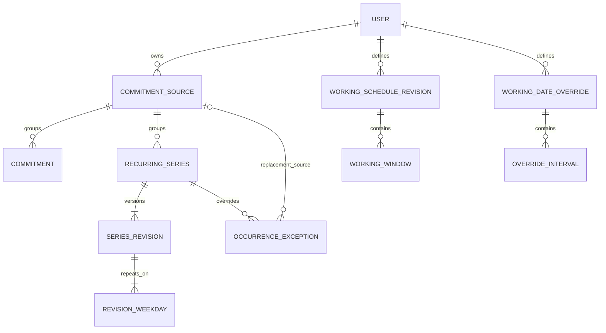

# Database design

Status: requirements DB1–DB17 and the schema/migration plan were confirmed in
DB18. Source archival, the recurring database foundation, and recurring
calculation/write services are implemented. Working-availability
tables and conflict/frontend integration remain scheduled increments. Existing
user data is preserved.

See the [project specification](project_spec.md), [glossary](../GLOSSARY.md),
and [development checklist](development_checklist.md).

## Current database and proposed change

The scheduling entities now include User, CommitmentSource, the one-time
Commitment, RecurringSeries, SeriesRevision, RevisionWeekday, and
OccurrenceException. Source ownership determines commitment ownership. Source
references are protected against deletion, and sources have nullable archival
state. One-time deletion remains permanent. Working-availability tables are not
implemented yet. Current forms reject missing/repeated local clock times.

The proposal preserves those three entities and adds eight entities. Django's
internal auth, permissions, sessions, and admin tables are additional framework
tables. This proposal is not a database reset or an inferred conversion of
existing commitments into repeating schedules.

## Confirmed requirements

| Decision | Confirmed behavior |
| --- | --- |
| DB1 | One personal pool of work availability shared across employers. Accepted shifts reduce it once recorded as commitments. |
| DB2 | Archive retired sources and preserve their commitments. |
| DB3 | Future-effective changes preserve earlier weeks; one-off anomalies are supported. |
| DB4, DB6 | Calculate current availability on request; do not retain previously shared reports. |
| DB5 | Display-timezone changes preserve original commitment schedules. |
| DB7 | Explicit one-off changes survive later general schedule changes. |
| DB8 | Cancel an individual occurrence without changing the recurring pattern. |
| DB9 | Support date-specific working availability. |
| DB10 | Archiving alone preserves future scheduled commitments and does not end a series. |
| DB11 | A date override replaces the complete local date, including incoming overnight portions. No intervals means unavailable all day. |
| DB12 | An all-future edit affects every selected weekday of that recurring commitment from the chosen date. |
| DB13 | Ending a series stops occurrences and replacements whose original start date is on/after the cutoff. |
| DB14, DB16 | Automatically move a missing clock endpoint forward by the transition gap. Show the result and allow a date-specific override. |
| DB17 | Automatically choose the first repeated clock time. Show the choice and allow a date-specific override. |
| DB15 | Explicit correction/deletion of mistaken past one-time entries is allowed; an immutable audit log is not required. |

Each person has a private account. Employers have no accounts. Weekly recurrence
uses selected weekdays, fixed local start/end clocks, start date, and optional
end date. Overnight entries and working windows are required. The initial zone
is America/Halifax; adaptive display time zones remain follow-up work.

## Proposed ER diagram

## Field catalog

Every entity retains or receives its own primary key. Existing user, source,
and commitment IDs remain unchanged. Source and series ownership are immutable
through ordinary application operations.

| Entity | Fields besides primary key | Purpose and main rules |
| --- | --- | --- |
| User | Existing auth fields; future display-timezone preference | Account boundary. Display preference does not rewrite schedule rules. |
| CommitmentSource | owner, name, color, nullable archived_at | Personal grouping. Keep exact-name uniqueness per owner. Archive preserves related records. |
| Commitment | source, title, starts_at, ends_at | Existing one-time occupied interval; end must follow start. |
| RecurringSeries | source, time_zone, starts_on, nullable ends_before | Stable recurring identity and original IANA zone. Overall lifetime is based on original occurrence start dates. |
| SeriesRevision | series, effective_from, nullable effective_until, title, start_time, end_time, end_day_offset, dst_gap_policy, dst_fold_policy | Regular local-clock schedule for a period. Its intersection with the series lifetime generates occurrences. |
| RevisionWeekday | revision, weekday | Selected weekdays, unique per revision. Clock times are stored once on the revision. |
| OccurrenceException | series, original_start_date, kind; nullable replacement_source, replacement_title, starts_at, ends_at | One cancellation or full replacement per series/date. Replacement fields are required together for rescheduling and absent for cancellation. Replacement source must have the same owner as the series. |
| WorkingScheduleRevision | owner, time_zone, effective_from, nullable effective_until, dst_gap_policy, dst_fold_policy | A person's working schedule for a period; not an employer-specific schedule. |
| WorkingWindow | revision, weekday, start_time, end_time, end_day_offset | Multiple windows per weekday, including overnight. Reject exact duplicates; merge overlapping windows during calculation. |
| WorkingDateOverride | owner, local_date, time_zone | Complete working availability on one date, unique per person/date. Stored zone defines the local date. |
| OverrideInterval | override, starts_at, ends_at | Zero or more positive intervals inside that override's local date. Zero intervals closes the entire date. |

### Types and ownership

- New primary keys use Django BigAutoField with matching foreign keys. Keep the
  current Commitment table and identifiers.
- Actual instants and archived_at use timestamp-with-time-zone. Effective and
  lifetime bounds use dates. Recurring clocks use time-without-time-zone, with
  a separately validated IANA zone name.
- Weekday uses Monday=0 through Sunday=6; end_day_offset is 0 or 1.
  Same-day end must follow start; overnight end is on the following date.
- Keep source names at 80 characters, titles at 160, and colors at seven
  characters with #RRGGBB validation. Required names/titles are validated in
  forms/models alongside non-null columns.
- Store dst_gap_policy=shift_forward and dst_fold_policy=first on revisions.
  Future default changes require new revisions; they do not rewrite old policy
  values. One-time/replacement records store the resolved actual instants.
- Commitment and RecurringSeries inherit ownership through their source.
  Working schedules and date overrides belong directly to User. There are no
  employer-account or employer-specific availability tables in this version.

PostgreSQL timestamps retain an instant, not its original IANA zone. Local rules
therefore retain the zone separately. [PostgreSQL timestamp storage](https://www.postgresql.org/docs/current/datatype-datetime.html#DATATYPE-DATETIME-INPUT-TIMESTAMPS)

## Temporal rules

### Revisions and series lifetime

Use half-open revision periods: effective_from is included, effective_until is
excluded, and null means open-ended. A future-effective change closes the prior
revision at the selected date and creates its successor in one transaction.
Preserve earlier revisions.

RecurringSeries separately defines the overall lifetime [starts_on, ends_before).
Convert a user-facing inclusive final date to the following date. Its Sunday
overnight instance can finish Monday when Sunday's original start date is still
inside that lifetime.

The lifetime limits generation even if previously planned revisions remain
recorded beyond the series end. Ending a series suppresses original occurrence
dates on/after the cutoff, including replacement exceptions. It is distinct
from changing regular hours, which preserves explicit exceptions.

Revision periods must be positive and must not overlap for the same parent.
An overall series lifetime may be empty when explicitly cancelled before its
start: clamp the cutoff to starts_on and require ends_before >= starts_on.
Initial user-entered bounds still reject an end before the start.

### Occurrences and exceptions

An occurrence's identity is its series plus original scheduled start date.
Moving Monday's occurrence to Tuesday keeps Monday as its exception key.
Exceptions reference the stable series, not one revision.

Suppress the original occurrence whenever an exception exists, even if the
replacement is outside the requested week. Query replacements by their actual
interval as well as original keys, so moves into another week are not missed.
A preserved replacement remains explicit if a later pattern no longer selects
its original weekday. The series lifetime still limits its original date.

Validate that a new exception targets a real occurrence when it is created.
Later valid changes to the regular pattern must not invalidate that exception.
A cancellation has no occupied interval; a replacement retains its explicit
source, title, and actual interval.

Each series has one time block on its selected weekdays. Different recurring
blocks on the same weekday can be separate series under one source. All-future
editing changes every selected weekday from the chosen date.

### Date override precedence

1. Expand weekly working windows and clip their portions to each local date.
2. When an override exists, replace that date's complete working availability,
   including incoming overnight portions, with its override intervals. No
   intervals means unavailable for the whole date.
3. Subtract occupied commitments, regardless of whether their sources are archived.

An override interval lies between that date's local midnight and the next
date's local midnight; its end may equal the next midnight. Represent an
overnight one-off willingness period with intervals on both affected dates.
Compute both midnight instants separately: a local date need not contain
24 elapsed hours. [PostgreSQL timezone conversion](https://www.postgresql.org/docs/current/functions-datetime.html#FUNCTIONS-DATETIME-ZONECONVERT)

## Automatic daylight-saving policy

Normal offset changes are calculated from the stored IANA zone. A recurring
09:00 meeting stays at 09:00 in its schedule's zone. A Halifax 22:00–06:00 shift
crossing a transition can have seven or nine elapsed hours while retaining its
local endpoints. Compare and subtract instants in UTC.
[Python ZoneInfo](https://docs.python.org/3.13/library/zoneinfo.html#using-zoneinfo),
[Python datetime arithmetic](https://docs.python.org/3.13/library/datetime.html#datetime-objects)

For a missing clock endpoint, move forward by the actual transition gap for that
date only. For a repeated endpoint, choose the first occurrence. Show the
resolved time and allow an explicit date-specific override. These are confirmed
application policies, not assumptions inferred from a timezone name.

Automatic resolution must still produce a positive UTC interval. Moving a
missing 02:30 start forward can turn 02:30–03:30 into a zero-length interval or
02:30–03:00 into a reversed interval. Such cases require review; do not silently
drop the commitment or present affected availability as complete. The existing
one-time forms reject ambiguous/nonexistent inputs until the new resolver is
implemented.

Store the policies on revisions so later defaults cannot reinterpret earlier
schedules. Zone attachment alone does not validate missing times.
[PEP 495](https://peps.python.org/pep-0495/#mind-the-gap)

Shifting generated gaps is a deliberate application policy. RFC 5545 treats
explicit DATE-TIME values differently from invalid generated recurrence
instances; do not describe this policy as universal calendar-standard behavior.
[RFC 5545 explicit times](https://www.rfc-editor.org/rfc/rfc5545.html#section-3.3.5),
[RFC 5545 recurrence](https://www.rfc-editor.org/rfc/rfc5545.html#section-3.3.10)

## Integrity and deletion rules

| Rule | Enforcement |
| --- | --- |
| Parent records exist | Foreign keys. |
| Source name per owner; weekday per revision; exception per series/date; override per owner/date | Unique constraints. |
| Valid weekday/offset values, date bounds, positive actual intervals, cancellation/replacement field shape | Same-row checks and form/model validation. |
| No overlapping revision periods per series/person | PostgreSQL exclusion constraints on parent equality and date-range overlap, using btree_gist; implemented for series revisions, working revisions pending. |
| Preserve prior schedule revisions | Implemented atomic series write services; range exclusion alone does not preserve history. |
| Replacement source and series have the same owner | Implemented service validation; independent foreign keys do not enforce joined owner equality. |
| Override child belongs inside its parent's local date | Service validation using the parent's date/zone; a plain row CHECK cannot join the header. |
| Valid automatic DST resolution | Application resolver, followed by UTC interval validation. |
| Referenced sources cannot be erased accidentally | PROTECT on source references; archive through the normal application workflow. |

Use PROTECT from commitments, series, and replacement exceptions to sources, and
from revisions/exceptions to their stable series. Weekday rows use CASCADE from
their revision. Working-window rows use CASCADE from their working revision;
override intervals use CASCADE from their date header. Historical rules remain
preserved by the write services.

Protection can prevent raw account deletion when schedules reference its sources.
Account erasure requires a separate explicit cleanup workflow; it is not
introduced here. Deliberate past one-time correction/deletion remains available.
Normal source choices hide archived sources for new assignments; editing an
existing commitment must allow keeping its current archived source so that
retirement does not prevent corrections or cancellation.

Create each valid recurring series with a first revision and at least one
weekday in one transaction. Working revisions and date overrides may have zero
intervals intentionally. Keep foreign-key and constraint indexes initially;
add other indexes when implemented bounded queries justify them.

### PostgreSQL-specific choice

Use Django ExclusionConstraint and the btree_gist database extension to prevent
concurrent overlapping effective revisions. This is a database dependency, not
an additional Python package. Actual occupied intervals remain allowed to
overlap after confirmation; the exclusion is on revision validity periods.

PostgreSQL becomes the authoritative backend for the full database/migration
suite. SQLite cannot run the full schema or verify the PostgreSQL exclusion
behavior. Migration 0003 installs btree_gist before adding the series exclusion.
[PostgreSQL range constraints](https://www.postgresql.org/docs/current/rangetypes.html#RANGETYPES-CONSTRAINT),
[Django exclusion constraints](https://docs.djangoproject.com/en/6.1/ref/contrib/postgres/constraints/)

Coordinate revision changes and related writes with atomic transactions and
stable-parent row locks. Same-row CHECK constraints cannot validate joined or
cross-row ownership rules.
[PostgreSQL constraints](https://www.postgresql.org/docs/current/ddl-constraints.html),
[Django transactions](https://docs.djangoproject.com/en/6.1/topics/db/transactions/),
[Django row locking](https://docs.djangoproject.com/en/6.1/ref/models/querysets/#select-for-update)

## Stored versus calculated

Store sources, one-time commitments, recurring revisions, explicit exceptions,
working schedules, and date overrides. Generate occurrences for the requested
range. Derive conflict indicators, free intervals, proposed-shift results, and
copyable availability. There are no saved availability reports, conflict-history
records, immutable audit logs, or generated-occurrence tables in this design.

## Migration and implementation sequence

DB18 confirmed this sequence. Steps 1–4 are complete for the recurring
foundation. Step 5's recurring services are implemented; conflict/frontend
integration and subsequent working-availability tables remain pending:

1. Record the pre-migration state and take a local database backup. Use migration
   tests with representative legacy records; do not expose private user data in
   test output.
2. Add nullable source archival state and protective deletion behavior. Existing
   sources stay active; preserve all one-time IDs, titles, sources, and instants.
3. Add series, revision, weekday, and exception tables in the next increment.
   Start them empty; do not infer repeating patterns from existing commitments.
4. Install btree_gist through a migration before adding temporal exclusions.
   Update test settings and documented commands to use PostgreSQL for the full
   integrity/migration suite.
5. Implement tested creation, future-effective changes, ending, exception, and
   DST-resolution services before enabling their frontend flows.
6. Add working revisions/windows and date overrides in a separate increment,
   followed by availability and calendar queries.
7. Run existing auth/one-time tests plus temporal, isolation, concurrency, and
   migration-preservation cases on PostgreSQL. Verify the running app before
   marking each increment complete.

The eleven-entity design is implemented in increments, not all at once. The
earlier eight-hour estimate applied to a smaller scope; it is not an estimate
for all newly confirmed history and exception behavior.

## Design validation checklist

These are reviewed design scenarios, not executed tests for future features.

| Scenario | Required outcome |
| --- | --- |
| One-time Sunday overnight commitment | Blocks Monday too, including across displayed weeks. |
| Future-effective change from November 16 | Earlier weeks retain their previous schedule. |
| Moved occurrence followed by a regular-hours change | Explicit replacement survives. |
| Move into a different week | Original is suppressed; replacement appears in its actual week. |
| Cancel one occurrence | Its time is freed; regular recurrence continues. |
| End a series | Suppress occurrences/replacements by original start-date cutoff; preserve earlier history. |
| Archive a source | Existing future commitments still block time. |
| Full-date override with overnight carry-in | Replace the entire date; an empty override offers no hours. |
| Overnight window crossing DST | Retain local clocks; calculate actual elapsed time in UTC. |
| Missing or repeated local clock input | Apply shift-forward/first policy visibly, allowing an override. |
| Automatic resolution produces an invalid interval | Request review and mark affected availability incomplete. |
| New exception references another user's source | Reject it; no cross-user ownership change or disclosure. |
| Two writes create overlapping revision periods | Both cannot commit; enforce the exclusion constraint. |
| Migration of existing one-time data | IDs, titles, sources, and instants remain unchanged. |
| User corrects a past one-time mistake | Allow explicit correction/deletion without an immutable audit log. |

## Implementation evidence and limits

DB18 confirmed the ER diagram, fields, enforcement layers, PostgreSQL testing
choice, and migration sequence. Migrations 0002 and 0003 are applied locally.
Existing users, source fields, and one-time commitments were compared before
and after migration and remained unchanged. New recurrence tables start empty.
A private pg_dump backup was created and its archive listing validated before
migration; it is a local recovery artifact, not part of the repository.

All 170 PostgreSQL tests pass. The suite covers legacy migration preservation,
temporal exclusion (including concurrent inserts), payload/weekday/date constraints, deletion
protection, and source archival behavior. New-source choices exclude archived
sources; existing commitments can keep theirs. The archive service checks
ownership and locks the source row, as does commitment assignment. The live HTTP
check also passed login, overnight CRUD, conflict confirmation, archived-source
correction, and logout; its temporary account and records were removed.

Recurring services now implement atomic creation with a first revision and
weekdays, future edits, series ending, occurrence validation/cancellation/
rescheduling, DST resolution, and bounded occurrence expansion. No recurring
writes are exposed through browser routes, APIs, or admin; conflict warnings
and frontend integration must precede enabling those flows. Database checks
do not enforce cross-row ownership, continuous revision coverage, immutable
history, or at least one weekday; the services enforce these workflow rules.
See [recurrence_services.md](recurrence_services.md) for interfaces and evidence.
Archival currently has a service and admin visibility; user-facing source
management controls remain to be added.

The architectural rationale is recorded in the
[accepted ADR](adr/0002-temporal-schedules-and-explicit-exceptions.md).
